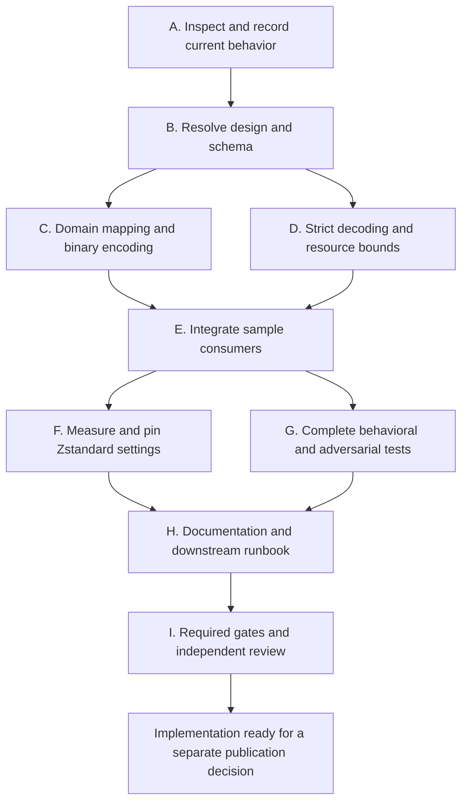

# Compressed baseline implementation goal

This execution plan implements [Compressed Protobuf baselines](COMPRESSED-BASELINES.md).
The immediate deliverable is a verified Tuiscotti implementation and a downstream
regeneration runbook. It does not start implementation merely by existing.

The copyable prompt below starts that implementation work. Merge, release, and
changes to downstream repositories are later phases with explicit prerequisites.
A goal that ends before those phases MUST describe its completion as Tuiscotti
implementation completion, not completion of the whole downstream rollout.

## Model assignments

Use GPT-6.1-Terra at low or medium effort for planning, design, task instructions,
implementation, tests, documentation and execution. Use GPT-6.1-Sol at low or
medium effort only for independent reviews during execution. Terra workers
receive a finished task contract; they do not fill gaps in the architecture or
decide what the product should do.
These are role assignments, not assumptions about relative API prices.

| Role | Model and effort | Responsibility |
|---|---|---|
| Planning and design | `gpt-6.1-terra`, `medium` | Write every task contract, schema, interface, algorithm, test case, benchmark method and substantive documentation change before dispatch. |
| Bounded Rust work | `gpt-6.1-terra`, `medium` | Turn the reviewed contract into Rust code and tests, then run the specified checks. |
| Mechanical work | `gpt-6.1-terra`, `low` | Apply exact filename, help-text, documentation and fixture edits; run specified commands and collect outputs. |
| Independent review | `gpt-6.1-sol`, `low` or `medium` | Review design, security-sensitive boundaries, benchmark conclusions and the final integrated artifact. |

Keep the coordinator on Terra at low or medium effort when the runtime supports
that choice. Its role is dispatch, state tracking, integration and command
execution. Terra medium resolves design and correctness decisions, incorporating review findings.
Start the execution session on Terra if a Terra coordinator is desired; the
prompt cannot change the active session's model. Terra writes instructions and code;
Sol low or medium reviews them; Terra remains the default code-writing worker. Do not silently
replace a requested model if it is
unavailable. Report the limitation and keep any dependent review gate open.

## Copyable implementation prompt

```text
/goal Implement binary-only Tuiscotti sample and baseline persistence according
 to docs/COMPRESSED-BASELINES.md and the task plan in
 docs/COMPRESSED-BASELINES-GOAL.md. Read AGENTS.md, CLAUDE.md, any nested repository
 instructions, and the current sample, comparison, acceptance, artifact, render
 and CLI code before editing. Treat the user's settled decisions as requirements.

 Use compressed Protobuf in .tui.pb files. Zstandard is required. Select the
 strongest measured Zstandard setting that fits the explicit resource limits.
 Preserve every domain field, existing comparison results, exact-byte approval
 digests, state_digest, PNG/RGBA identities, and the existing approval transaction.
 Remove JSON sample/baseline readers, writers, serde entry points and fallback
 paths in this change. Do not add a converter, compatibility period, automatic
 baseline approval, new review application, or live terminal functionality.
 CLI result JSON and unrelated evidence metadata JSON remain separate contracts.

 Have GPT-6.1-Terra medium write the substantive design, complete task contracts,
 implementation instructions, test cases and expected results, documentation
 text and benchmark method. Resolve the specification review findings and
 publish the concrete schema, nested tags, error mapping and bounded decoder
 design before implementation dispatch. Obtain independent Sol medium review.
 Give GPT-6.1-Terra medium exact bounded Rust tasks and Terra low exact mechanical
 edits and commands. Each contract must include the interfaces, file ownership,
 ordered edits, invariants, tests and expected outputs in the template below.
 Terra implements those instructions. It must stop its task and report any
 missing decision or contradiction instead of inventing a design. Terra medium
 diagnoses the gap and writes a corrected contract before execution resumes.
 Have an independent Sol medium reviewer inspect actual diffs and outputs at each
 required gate. The Terra coordinator tracks and integrates approved work; it
 owns integration and uses Sol only for independent reviews.

 Follow the sequenced tasks below. Keep at most four agents active including
 the coordinator. Separate concurrent writers into isolated worktrees and give
 shared files one owner. Before dispatch, preserve uncommitted instructions and
 ensure each worktree receives the reviewed spec and plan, either from an
 authorized signed task-branch commit or a verified immutable snapshot. Record
 decisions, evidence, open findings and task
 completion locally. Preserve unrelated user work. Do not create extra cargo
 workspace features or forbidden direct terminal dependencies. Edit generated
 workflows only through their source configuration and regeneration.

 Capture a pre-change behavior oracle before replacing the format. Implement
 the complete private Protobuf mapping and strict bounded Zstandard/container
 decoder. Update all sample consumers, paths, errors, evidence links and tests
 together. Update Rust, mr-boxington (mbx), all other pinned tools and workspace
 dependencies to their latest stable releases available when this goal runs.
 Check authoritative release sources; do not guess versions. Update lockfiles,
 declared Rust version and generated configuration as needed. Resolve breaking
 changes and document any dependency that cannot be updated, with evidence.
 Keep the workspace boundary and prohibited direct-dependency rules intact.
 Benchmark actual Protobuf messages from representative real captures,
 checkout bytes, Git storage over realistic changes, processing time and peak
 memory. Do not use the preliminary JSON compression comparison as the final
 decision. Record pinned Zstandard settings and dependencies in DECISIONS.md.

 Prove full-value round trips, comparison equivalence, malformed/oversized input
 rejection, binary-only reading, read-only checks, exact-byte acceptance,
 CI refusal, locking and concurrent evidence behavior. Run all repository gates
 with the pinned toolchain, including nextest for integration tests, and verify
 documentation links and README examples. Obtain an independent Sol medium review
 of the final revision and resolve every accepted finding with focused rechecks.

 Prepare the downstream inventory and exact regeneration/upgrade runbook for
 terminal-components-baseline main, terminal-components-baseline PR #2 and
 jackin PR #1264. Recheck their live heads before describing current state.
 Before merge, use only disposable downstream worktrees or copies to pin the
 local implementation, capture benchmark samples and rehearse regeneration.
 Do not alter existing branches, active baseline roots, PR heads or published
 dependency pins. Actual downstream upgrades wait for the merged commit SHA.
 Baselines must be freshly regenerated and explicitly approved, never converted
 or auto-blessed.

 At startup, inventory the required cross-platform runners and record a concrete
 validation route. Report missing runners before the long implementation work;
 continue independent work, but leave the goal incomplete without evidence.

 Finish this goal when the Tuiscotti implementation, tests, documentation,
 reproducible benchmark evidence and independently reviewed downstream runbook
 are complete, all requested toolchain and dependency updates are verified,
 all required local gates pass, and cross-platform determinism is
 verified for the supported platforms. Missing required platform evidence is
 NOT VERIFIED and prevents goal completion. Report concrete evidence and
 limitations. Do not open/publish a PR, merge, release a package, rewrite shared
 history or replace downstream baselines in this run. Those are separate rollout
 steps after their prerequisites and authorization are established.
```

The prompt deliberately completes the implementation phase. It does not create
an indefinitely waiting goal whose completion depends on a future merge or
release outside its authorized scope.

## Task order and ownership

The dependency order is:



Tasks C and D may run concurrently only after B fixes their signatures and file
ownership. F and G can run independently after integration, but benchmark
processes MUST run without test/build contention. Tests that discover new defects
return to the owning implementation task and invalidate affected measurements.

### A. Inspect and record current behavior

Terra medium writes the inventory questions, behavior-oracle cases and exact expected
assertions. Terra low performs the inventory and commands. Terra medium implements
the specified oracle tests. Terra medium resolves newly discovered behavior and an
independent Sol medium reviewer checks coverage before format replacement.

Inputs include `sample.rs`, `check.rs`, `approve.rs`, `render.rs`, `report.rs`,
CLI input/error/result handling, integration helpers, and the public/module docs.
Record every `.tui.json` path and public JSON sample entry point, including tests,
examples, docs and artifact links. Keep machine-readable result metadata distinct
from persisted samples. The workspace library has `test = false`; use its actual
integration host rather than assuming unit tests in that crate will run.

Capture pre-change pass/failure outputs and state digests for fixed logical
samples constructed through public builders. Include metadata-only changes,
policy/state/contract/dimensions/pixels, observation differences and equal RGBA
with different PNG bytes. Store semantic expectations, not only a snapshot of
file hashes that necessarily change with the new format.

Completion evidence is a source/path inventory, runnable oracle cases and a
baseline validation result. No baseline approvals change in this task.

Inventory Rust, mr-boxington, all pinned tools and workspace dependencies. Check
their latest stable versions against authoritative sources at execution time.
Record current and target versions, release evidence, compatibility constraints
and updates required in manifests, lockfiles, toolchain files, documentation and
generated configuration. Assign Terra medium to version and compatibility
decisions, Terra low to bounded edits and commands, and Sol low or medium only
to independent review. Apply and validate the updates before implementation
benchmarks so the measurements use the versions that will ship. If a required
update cannot be completed, report the blocker and leave the goal incomplete
unless the user explicitly changes the requirement.

Before implementation, record the platform matrix, runner access, commands and
artifact comparison method. At minimum include the platforms currently tested
in [Limitations](LIMITATIONS.md): `aarch64-apple-darwin` and
`x86_64-unknown-linux-gnu`. Check current project policy for additional supported
platforms rather than treating this minimum as a new support restriction. Run
the same fixed, fully specified sample and pinned encoder on each available
runner; compare the complete encoded file bytes or cryptographic digests and
retain the commands, target triples, tool versions and results. Report an
unavailable required runner immediately as `NOT VERIFIED`. Continue work that
does not depend on it, but do not mark the goal complete without its evidence.

### B. Resolve design and schema

Assign Terra medium to the design and task contracts, with an independent Sol medium
review. Terra low can gather dependency/tool availability evidence.

Before coding, settle all of the following:

1. The complete nested `.proto` tag/enum inventory, presence, checked integer
   widths, exact float representation and public-builder mapping.
2. The pinned Protobuf/runtime generation method, golden fixtures and dependency
   policy. State whether generated files are checked in and whether `protoc` is
   needed. Build from the supported offline environment without hidden downloads.
3. The container/Zstandard framing, checksums, single-frame handling, decoder
   window, cumulative allocation budget, scan-before-allocation algorithm and
   strict rejection rules. Assign one owner to the wire descriptor/schema so
   a scanner and generated decoder cannot drift silently.
4. Error variants/codes, binary-only entry points, public serde removal, retained
   internal state-digest projection, filenames and artifact/result links.
5. Benchmark corpus construction and budgets. Establish a way to compare identical
   logical captures without adding a JSON converter or reader to the product.

Define how integration tests construct malformed wire fixtures without exposing
private production wire types. Confirm that the chosen test target actually runs
under nextest, since the library sets `test = false` and public constructors
cannot create every invalid state.

Public JSON removal MUST NOT remove serde needed by unrelated CLI/result metadata
or upstream snapshots. Keeping an internal projection solely to preserve the old
state digest is allowed by the spec; exposing it as a sample serializer is not.

Completion evidence is a concrete design artifact, complete contracts for the
next executable tasks and an independent review with no unresolved blocking
findings. The current document gives task boundaries, not an already completed
nested schema or decoder algorithm. Terra medium must write those concrete artifacts and Sol medium must review them
at B before Terra receives implementation work.

### C. Implement domain mapping and binary encoding

Terra medium writes the exact private types, field mapping, encoding sequence and
round-trip assertions. Assign Terra medium to implement that reviewed contract.
The coordinator alone integrates changes to shared `sample.rs`, `lib.rs`, Cargo
manifests and `Cargo.lock`, or explicitly gives those files one worker owner.

Map all fields, including metadata, empty option values, color kinds, palette
ordering, cursor details, full-width integers, floats and exact PNG bytes. Preserve
the existing base64 accessor if its public contract remains. Encode canonical
message bytes and the 32-byte header. Remove the JSON sample persistence API
rather than leaving unused compatibility code.

Add meaningful full-field round trips and golden bytes. Equality tests must
project metadata explicitly because upstream snapshot equality excludes it.
Sol medium reviews the mapping and deterministic serialization before integration.

### D. Implement strict decoding and resource bounds

Terra medium writes the scan/decode algorithms, allocation accounting, failure
precedence and adversarial cases. Assign Terra medium to implement that complete
contract. Use distinct modules/worktree from C. Sol medium independently reviews
this task's boundary code before integration.

Validate lengths, magic, versions, codec ID, exact frame consumption, checksums,
window and expanded-byte limits before allocating untrusted claims. Scan the
Protobuf wire structure before owned decoding. Reject unknown fields, duplicate
singular fields and union alternatives, unsupported enums, invalid UTF-8,
overflows, forbidden wire types and resource-limit violations as specified.

Prove limit-minus-one, exact-limit and limit-plus-one behavior at the relevant
boundaries using small malicious headers/messages where possible. Rejections must
be typed, bounded and panic-free. Do not reinterpret unsupported JSON as success
or route it through a leftover serde parser. Scope the fuzz run by recorded seed,
duration and covered decoder entry points; report observed coverage honestly.

### E. Integrate all consumers

Terra medium specifies each consumer change, exact path/error behavior and integration
test expectation. Assign Terra medium to those edits. Terra low handles exact
filename/help-text replacements from the same reviewed contract.

Update baseline lookup, acceptance, candidate/expected evidence, artifact links,
render/report sample loading, CLI limits/error mappings, helpers and examples.
Use `.tui.pb` consistently. A binary baseline missing beside an old JSON file
must remain missing. No fallback, implicit conversion or rewrite occurs.

Acceptance keeps exact candidate bytes, digest arbitration, re-render/identity
verification, stable lock, CI refusal and atomic single-file replacement. Running
checks, rendering and reports never writes active baselines. Keep ordinary CLI
result JSON and its schema intact.

Completion evidence is real CLI execution against valid binary samples, rejected
JSON, a missing/different/pass check, staged acceptance and offline rendering.
Sol medium reviews acceptance and artifact compatibility before broad validation.

### F. Measure and pin Zstandard settings

Terra medium writes the measurement method, tool interfaces, corpus selection,
commands, validation rules and decision criteria. Assign Terra medium to build
that specified tool and Terra low to execute it. Sol medium reviews the evidence and selection. Terra medium writes or revises the
setting decision when the evidence requires a design choice. Benchmark
execution is serial even if other read-only work continues.

Measure actual canonical Protobuf bytes from fresh representative captures. For
historical JSON controls, use the pre-change executable/worktree or a standalone
research-only producer consuming the same constructed logical capture. Do not ship
or introduce a baseline converter or JSON sample reader in the new product.
Record when historical corpus sizes describe different captures rather than
presenting those numbers as equivalent-input codec results.

Before merge, disposable downstream worktrees or copies may temporarily point
to the local candidate to produce fresh capture inputs. Keep their output and
benchmark Git databases separate from active baselines and existing branches.
Scratch commits in isolated benchmark repositories are allowed for Git-history
measurements. Do not commit to existing downstream branches, push, modify PR
heads or publish dependency pins as part of this benchmark. Preserve unrelated
local changes.

Measure Zstandard high settings under the specified window cap, including the
highest legal setting. Keep JSON/raw Protobuf/other codecs as controls required
by the spec. Record corpus/file hashes, exact commands, tool versions, successful
round trips, five or more interleaved runs, ranges and medians, CPU/wall time and
peak memory. Validate end-to-end check/accept/read paths as well as codec work.
Do not choose by speed measurements collected under uncontrolled contention.

Use isolated Git object databases and the same logical revisions/repack settings
for history comparisons. Include real small state/style/palette/metadata/pixel
changes and additions/deletions. Report fresh-history, incremental-history and
retained-old-history costs separately. A smaller checkout does not prove smaller
Git history. Record the selected deterministic Zstandard parameters and pinning
policy in `DECISIONS.md`, then rerun affected tests with the final settings.

### G. Complete behavioral and adversarial validation

Terra medium writes the concrete test matrix, fixture construction steps, assertions
and expected errors. Terra medium implements those tests; Terra low applies
specified case expansions and runs commands. An independent Sol medium reviewer
checks that assertions test observable behavior and cover the spec.

The matrix includes:

1. Full-value round trips, every color/enum/presence distinction, metadata,
   observation, float bits, PNG bytes and deterministic bytes across platforms.
2. Pre-change comparison-oracle results, all mismatch categories, state digests,
   PNG re-encoding equivalence and metadata-only equality.
3. JSON rejection through every sample input, malformed header/wire/frame/PNG,
   decompression/window/allocation limits, trailing/concatenated input and fuzzing.
4. Filesystem/process behavior, read-only checks, CI refusal including empty CI,
   stale digests, locks, symlinks, concurrent evidence and old/new atomic reads.
5. CLI argument/result compatibility, binary paths, evidence links, report/render
   sample loading and exact candidate/baseline digest equality on acceptance.

Demonstrate regeneration in a disposable rehearsal tree. Capture representative
fresh samples, explicitly approve them into a separate staging root on a
workstation, validate the resulting `.tui.pb` paths and checks, and retain the
original tree. Record the captures, approval results and validation commands.
This satisfies the implementation-phase rehearsal; it does not complete the
later downstream replacement.

A passing compile is not completion evidence. Run the feature and inspect the
actual output/files. Re-run only affected lanes after changes, then run the full
repository gates once the integrated artifact stabilizes.

### H. Update documentation and downstream runbook

Terra medium writes the substantive documentation text and downstream instructions
from the final design and measurements. Terra low applies the approved text and
runs link checks. An independent Sol medium reviewer checks the final contracts
and rollout instructions.

Update README fences, public API/snapshot/CLI docs, included module docs, durable
decisions and applicable current migration guidance. Preserve frozen history.
Check every touched relative link. Document JSON rejection, `.tui.pb`, byte
identity, regeneration, rollback and the chosen compression/resource settings.

Verify the task A updates to Rust, mr-boxington, other pinned tools and workspace
dependencies. Confirm that affected version pins, the declared Rust version,
lockfiles and generated files agree. Resolve required API or build changes and
rerun the affected tests and dependency checks. If an update is incompatible or
unavailable, retain evidence of the blocker and leave the goal incomplete.

Prepare a downstream inventory with current head SHAs, actual capture commands,
Tuiscotti dependency/CLI pins, active baseline roots, fixtures, script/CI suffix
assumptions, receipt/check-script digest verification, approval process and owner
instructions. Verify the current scripts rather than assuming historical receipt
formats can be reused unchanged. The named targets are:

1. `tailrocks/terminal-components-baseline` main.
2. `tailrocks/terminal-components-baseline` PR #2.
3. `jackin-project/jackin` PR #1264, upgrading its Tuiscotti integration even if
   the live head has no committed JSON baseline files.

Do not infer that every JSON file is a Tuiscotti sample. Keep unrelated JSON and
historical receipts. Generated CI changes follow each repository's generator
rather than direct edits. Record downstream prerequisites rather than making
unavailable merged/released versions appear complete.

### I. Run gates and independently review the final artifact

Assign Terra low to command execution and evidence collection. Sol medium reviews
the complete final diff, source, tests, raw measurements and docs. The final
reviewer must not be the agent that wrote the reviewed change.

Run from the repository root with the pinned toolchain:

```sh
cargo fetch --locked
cargo fmt --all -- --check
cargo clippy --workspace --all-targets --locked --offline -- -D warnings
cargo nextest run --workspace --locked --offline
cargo test --doc -p tuiscotti --locked --offline
RUSTDOCFLAGS="-D warnings" cargo doc --workspace --no-deps --locked
```

Also run the repository's current generated-file/dependency checks when the
changed paths require them. Record the actual toolchain and any wrapper failure;
do not silently swap to an unpinned toolchain. Sign any authorized commits with
`git commit -s`.

Sol medium triages review findings as a fix or evidence-backed dismissal. Terra
medium writes any needed repair contract. Give those instructions to the cheapest
suitable worker, then have Sol medium recheck the changed boundary. Run affected
lanes after every fix. Final completion requires no unresolved accepted finding,
all required local gates green at the reviewed revision, and explicit limits on
claims that require external operations. Deterministic bytes must be verified on
the supported platforms at the final revision. Missing platform evidence is
NOT VERIFIED and blocks implementation completion. Narrow the supported platform
scope only through an explicit reviewed decision consistent with user requirements.

## Dispatch rules and cost control

Terra medium writes one contract for each small executable unit, then an independent
Sol medium reviewer checks any new design or boundary decision. The coordinator
dispatches only the reviewed contract. A broad instruction such as "implement
safe decoding" is a planning task for Terra medium, not a complete worker brief.

Use this contract format. Replace every placeholder before dispatch:

```text
Task <ID> / contract revision <ID>

1. Inputs and ownership
   Model and effort: <Terra low or medium, selected by the Terra coordinator>
   Base commit and instruction snapshot hashes: <exact values>
   Required reads: <specific source, spec and design sections>
   Files permitted to change: <exact paths and assigned symbols>
   Files and behavior forbidden to change: <explicit boundaries>
   Prerequisites: <completed task/review IDs and required artifacts>

2. Exact implementation instructions
   Interfaces/types/schema: <signatures, field/tag table, visibility, errors>
   Ordered edits: <bounded steps tied to paths and symbols>
   Algorithm: <complete pseudocode for non-mechanical logic>
   Edge cases: <presence, limits, overflow and failure precedence as relevant>
   Invariants: <observable behaviors that must remain true>
   Approved documentation text: <exact text or artifact pointer if applicable>

3. Verification
   Fixtures and setup: <construction steps and pinned inputs>
   Tests and assertions: <specific inputs, outputs, errors and unchanged values>
   Commands: <copyable commands from the repository root>
   Expected results: <exit status and concrete output/artifact checks>
   Pass criteria: <all required observations, not just compilation>

4. Stop and escalation rules
   If an interface is missing, an assumption fails, instructions conflict,
   an unlisted file must change or a new design decision is needed, stop this
   unit, preserve the diff and report the exact evidence to the coordinator.
   Do not guess, weaken checks, change the spec or broaden scope.
   Terra medium diagnoses the issue and issues a revised reviewed contract.
   A mechanical typo may be fixed locally only when behavior and scope stay
   exactly as specified; record it in the handoff.

5. Required handoff
   Contract ID and resulting commit/diff identity.
   Changed paths and completed instruction steps.
   Commands, exit statuses and actual observations/artifact paths.
   Deviations, unresolved concerns and any skipped verification.
   Verdict: READY FOR SOL MEDIUM REVIEW or BLOCKED ON CONTRACT <specific gap>.
```

The planner does not need to write every Rust statement for a contract to be executable.
It must settle every semantic choice and give sufficient types, algorithms,
examples and expected results for Terra to implement without designing the
feature. Terra may choose local names and formatting within the fixed contract.
It must return any semantic ambiguity to the Terra medium planner immediately, rather than making two
speculative implementation attempts.

Supply task context by verified file pointers instead of pasting the entire
transcript. The coordinator may dispatch independent ready tasks while Terra medium
resolves a blocked contract; it must not proceed with work that depends on the
unresolved decision.

When using Codex model or effort overrides, set `fork_turns` to `none` and
include all necessary task context and file pointers in the worker brief. Verify
the brief points to the reviewed versions of both documents, including when
they were uncommitted at startup.

Use at most three children with a four-agent capacity. Do not have two agents
edit one file or lockfile. Preserve cheap completed work while escalating only
the disputed decision. A failed assertion returns its exact evidence to the Terra medium planner when
the contract does not specify the repair. Terra medium writes the fix instructions;
Terra applies them. After two failed attempts at an already specified repair, Terra medium must
recheck the premise and rewrite the contract before another implementation
attempt. A reviewer unavailable at the required
model is a missing review, not permission to count worker self-review as approval.

Use Terra for commands, implementation, detailed planning and resolving design
gaps. Use Sol low for straightforward independent review and Sol medium for
security-sensitive boundaries, benchmark conclusions and the final review. Sol medium reviews the actual changed files, benchmark evidence and
outputs, not only the worker's handoff. Sol medium's acceptance closes each unit
before dependent work is integrated. Terra medium writes repair instructions when
needed. An independent Sol medium reviewer must review the final integrated
result and the substantive design, regardless of earlier worker-task approvals.
A failed gate or changed design invalidates the relevant previous review; it
does not require rerunning unrelated workers.

## Later rollout phases

These steps are outside the copyable implementation goal. They preserve the
user's required order and need their actual external prerequisites.
When those phases are authorized, Terra medium writes their concrete repository
instructions and review criteria before Terra executes them. This plan does not
give a lower-cost worker authority to invent capture, approval or release steps.

1. After the implementation PR merges, record the full merged commit SHA. Recheck
   each downstream target's live head and instructions. Pin dependency and CLI to
   that SHA, regenerate captures using the normal upstream capture workflow,
   review them and explicitly accept binary samples into a fresh staging root.
2. Validate staged baselines, replace the active JSON files with approved binary
   files as a reviewed repository change, update scripts/fixtures and lockfiles,
   and validate again. Preserve historical receipts and the old Git revision.
3. After the merged revision and downstream regenerations are verified, publish
   the authorized Tuiscotti release. Upgrade downstream dependency/CLI pins to
   that version and rerun their validation. Record completion by repository and
   revision, including both existing PR branches where still applicable.

No automatic acceptance or deletion runs merely because a dependency changed.
No step claims that replacing a whole baseline tree is atomic. If the capture
or approval environment cannot reproduce a sample, report the failed sample and
its evidence instead of converting or weakening it.

## Main risks to resolve before dispatch

The strict Protobuf policy requires more than a generated decoder's defaults.
The design must specify a maintained, bounded wire scanner and prove its schema
matches the decoder. This is the highest-risk code boundary.

Removing `Sample` serde while preserving `state_digest` needs a private canonical
projection with golden expectations. Removing all serde/JSON dependencies would
also break unrelated result metadata and is not the task.

The current spec deliberately leaves memory budget, nested schema, build strategy
and Zstandard settings open. Do not assign low-effort workers to guess these
choices. Resolve them at B and F and update the spec/decisions consistently.

The historical corpus is not a substitute for fresh regenerated captures. A
full downstream regeneration can require app-specific setup, human review and
multiple platform runners. Prepare the runbook now; do not mark those external
steps complete from local Tuiscotti tests alone.
