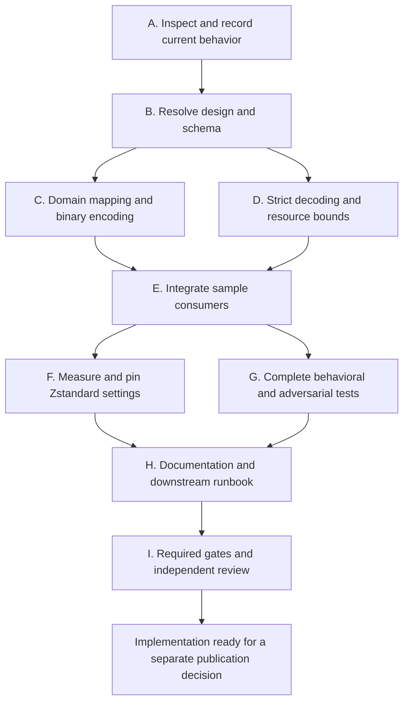

# Compressed baseline implementation goal

This execution plan implements [Compressed Protobuf baselines](COMPRESSED-BASELINES.md).
The immediate deliverable is a verified Tuiscotti implementation and a downstream
regeneration runbook. It does not start implementation merely by existing.

The copyable prompt below starts that implementation work. Merge, release, and
changes to downstream repositories are later phases with explicit prerequisites.
A goal that ends before those phases MUST describe its completion as Tuiscotti
implementation completion, not completion of the whole downstream rollout.

## Model assignments

Use Luna for most planning, edits, tests, documentation and command execution.
Use Terra when the task has a demonstrated correctness or design risk that a
bounded Luna task cannot safely resolve. Use Sol only for independent review.
Model and effort choices are task assignments, not claims about API prices.

| Work | Model and allowed effort | Starting assignment |
|---|---|---|
| Coordination, inventory and mechanical work | `gpt-6-luna`, `low` to `max` | Low for commands and exact edits; medium for dispatch and routine reasoning. |
| Bounded Rust, tests, tools, docs and task briefs | `gpt-6-luna`, `low` to `max` | Medium for fixed contracts; high for nontrivial local work. Use max only after high exposes a specific unresolved reasoning gap. |
| Schema, decoder, digest and approval decisions | `gpt-6.1-terra`, `low` to `high` | Medium for settled cross-module integration; high for strict decoding, allocation safety or a difficult design decision. |
| Focused independent review | `gpt-6.1-sol`, `low` to `medium` | Low for a bounded behavioral or documentation question. |
| Required risk and final reviews | `gpt-6.1-sol`, `low` to `medium` | Medium for schema/decoder safety, digest/approval preservation, benchmark conclusions and the final artifact. |

Start the execution session on Luna medium when that coordinator is available.
The prompt cannot change an active session's model. The coordinator tracks tasks,
checks evidence and integrates approved changes; it dispatches difficult decisions
rather than spending Terra or Sol calls on routine administration.

Give workers complete contracts before implementation. Luna may prepare routine
contracts from the settled design. Terra settles only the difficult contracts
identified below or an evidence-backed escalation. Sol reviewers report findings
and acceptance; they do not implement, write repair code or own task planning.
No execution task uses Sol high, Terra above high, Luna above max, or another
model. Do not silently substitute an unavailable requested model. Record the
limitation and keep any required review gate open.

## Copyable implementation prompt

```text
/goal Implement binary-only Tuiscotti sample and baseline persistence according
 to docs/COMPRESSED-BASELINES.md and the task plan in
 docs/COMPRESSED-BASELINES-GOAL.md. Read AGENTS.md, CLAUDE.md, any nested repository
 instructions, and the current sample, comparison, acceptance, artifact, render
 and CLI code before editing. Treat the user's settled decisions as requirements.

 Use compressed Protobuf in .tui.pb files. Zstandard is required. Select the
 strongest measured Zstandard setting that fits the explicit resource limits.
 Preserve every domain field, existing comparison results, exact-byte approval
 digests, state_digest, PNG/RGBA identities, and the existing approval transaction.
 Remove JSON sample/baseline readers, writers, serde entry points and fallback
 paths in this change. Do not add a converter, compatibility period, automatic
 baseline approval, new review application, or live terminal functionality.
 CLI result JSON and unrelated evidence metadata JSON remain separate contracts.

 Use only gpt-6-luna at low through max, gpt-6.1-terra at low through high,
 and gpt-6.1-sol at low or medium. Default the coordinator and most work to Luna.
 Start commands/exact edits at Luna low, bounded implementation/tests/docs at
 Luna medium, and nontrivial local reasoning at Luna high. Use Luna max only
 for a specific unresolved gap after high. Reserve Terra medium/high for the
 schema, strict decoder, digest/approval seams and evidence-backed escalations.
 Sol is review-only; batch its reviews at the risk gates in this plan. Do not
 call Sol or Terra to repeat routine checks, rename files or track task status.

 Resolve the concrete schema, nested tags, error mapping and bounded decoder
 design before dependent implementation. Give each worker a complete contract
 with interfaces, exact ownership, steps, invariants, tests and expected outputs.
 Luna writes routine briefs from the settled design; Terra handles difficult
 decisions. A worker reports missing decisions or contradictory evidence rather
 than guessing, weakening tests or changing scope. Escalate only the blocked
 unit under the rules below. Independent Sol medium reviews the required risk
 gates and final revision; use Sol low only for narrower review questions.

 Follow the sequenced tasks below. Keep at most four agents active including
 the coordinator. Separate concurrent writers into isolated worktrees and give
 shared files one owner. Before dispatch, preserve uncommitted instructions and
 ensure each worktree receives the reviewed spec and plan, either from an
 authorized signed task-branch commit or a verified immutable snapshot. Record
 decisions, evidence, open findings and task completion locally. Preserve unrelated user work. Do not create extra cargo
 workspace features or forbidden direct terminal dependencies. Edit generated
 workflows only through their source configuration and regeneration.

 Use the project's mise-managed mr-boxington (mbx) for Cargo build and test
 commands. Install the pinned tools, run mbx doctor, verify that the mise Cargo
 wrapper is active and run a workspace check through it. If the wrapper or mbx
 is unavailable, repair the setup and retry; report any unresolved failure
 instead of silently bypassing mbx.

 Capture a pre-change behavior oracle before replacing the format. Implement
 the complete private Protobuf mapping and strict bounded Zstandard/container
 decoder. Update all sample consumers, paths, errors, evidence links and tests
 together. Update Rust, mr-boxington (mbx), all other pinned tools and workspace
 dependencies to their latest stable releases available when this goal runs.
 Check authoritative release sources; do not guess versions. Update lockfiles,
 declared Rust version and generated configuration as needed. Resolve breaking
 changes and document any dependency that cannot be updated, with evidence.
 Keep the workspace boundary and prohibited direct-dependency rules intact.
 Benchmark actual Protobuf messages from representative real captures,
 checkout bytes, Git storage over realistic changes, processing time and peak
 memory. Do not use the preliminary JSON compression comparison as the final
 decision. Record pinned Zstandard settings and dependencies in DECISIONS.md.

 Prove full-value round trips, comparison equivalence, malformed/oversized input
 rejection, binary-only reading, read-only checks, exact-byte acceptance,
 CI refusal, locking and concurrent evidence behavior. Run all repository gates
 with the pinned toolchain, including nextest for integration tests, and verify
 documentation links and README examples. Obtain an independent Sol medium review
 of the final revision and resolve every accepted finding with focused rechecks.

 Prepare the downstream inventory and exact regeneration/upgrade runbook for
 terminal-components-baseline main, terminal-components-baseline PR #2 and
 jackin PR #1264. Recheck their live heads before describing current state.
 Before merge, use only disposable downstream worktrees or copies to pin the
 local implementation, capture benchmark samples and rehearse regeneration.
 Do not alter existing branches, active baseline roots, PR heads or published
 dependency pins. Actual downstream upgrades wait for the merged commit SHA.
 Baselines must be freshly regenerated and explicitly approved, never converted
 or auto-blessed.

 At startup, inventory the required cross-platform runners and record a concrete
 validation route. Report missing runners before the long implementation work;
 continue independent work, but leave the goal incomplete without evidence.

 Finish this goal when the Tuiscotti implementation, tests, documentation,
 reproducible benchmark evidence and independently reviewed downstream runbook
 are complete, all requested toolchain and dependency updates are verified,
 all required local gates pass, and cross-platform determinism is
 verified for the supported platforms. Missing required platform evidence is
 NOT VERIFIED and prevents goal completion. Report concrete evidence and
 limitations. Do not open/publish a PR, merge, release a package, rewrite shared
 history or replace downstream baselines in this run. Those are separate rollout
 steps after their prerequisites and authorization are established.
```

The prompt deliberately completes the implementation phase. It does not create
an indefinitely waiting goal whose completion depends on a future merge or
release outside its authorized scope.

## Task order and ownership

The dependency order is:



Tasks C and D may run concurrently only after B fixes their signatures and file
ownership. F and G can run independently after integration, but benchmark
processes MUST run without test/build contention. Tests that discover new defects
return to the owning implementation task and invalidate affected measurements.

### A. Inspect and record current behavior

Assign Luna low to inventory and commands, Luna medium to routine oracle tests,
and Luna high to planning their behavioral coverage. Escalate an ambiguous
comparison or digest contract to Terra medium with the source evidence. Review
oracle coverage as part of the task B design review rather than dispatching a
separate Sol reviewer for routine inventory.

Inputs include `sample.rs`, `check.rs`, `approve.rs`, `render.rs`, `report.rs`,
CLI input/error/result handling, integration helpers, and the public/module docs.
Record every `.tui.json` path and public JSON sample entry point, including tests,
examples, docs and artifact links. Keep machine-readable result metadata distinct
from persisted samples. The workspace library has `test = false`; use its actual
integration host rather than assuming unit tests in that crate will run.

Capture pre-change pass/failure outputs and state digests for fixed logical
samples constructed through public builders. Include metadata-only changes,
policy/state/contract/dimensions/pixels, observation differences and equal RGBA
with different PNG bytes. Store semantic expectations, not only a snapshot of
file hashes that necessarily change with the new format.

Completion evidence is a source/path inventory, runnable oracle cases and a
baseline validation result. No baseline approvals change in this task.

Verify the actual mbx setup before running build or test lanes. Install the
project's pinned tools with mise, check `mbx --version`, run `mbx doctor`, and
confirm its setup check reports the mise Cargo wrapper active. Run
`cargo check --workspace --locked --offline` through that wrapper and record
the command and result. Use the wrapper or a verified direct `mbx` invocation
for Cargo build and test commands, including nextest, Clippy and rustdoc. Verify
subcommand forwarding before relying on it. Do not invoke a raw Cargo binary
as a silent fallback. If setup fails, diagnose it, retry and report the blocker;
do not mark the required mbx-backed gate as passed.

Inventory Rust, mr-boxington, all pinned tools and workspace dependencies. Check
their latest stable versions against authoritative sources at execution time.
Record current and target versions, release evidence, compatibility constraints
and updates required in manifests, lockfiles, toolchain files, documentation and
generated configuration. Assign Luna low to release evidence and exact version
edits, Luna medium/high to ordinary dependency compatibility fixes, and Terra
medium only to breaking cross-module or toolchain issues beyond that scope.
Sol reviews substantive dependency risks with the relevant design or final gate.
Apply and validate the updates before implementation benchmarks so the measurements use the versions that will ship. If a required
update cannot be completed, report the blocker and leave the goal incomplete
unless the user explicitly changes the requirement.

Before implementation, record the platform matrix, runner access, commands and
artifact comparison method. At minimum include the platforms currently tested
in [Limitations](LIMITATIONS.md): `aarch64-apple-darwin` and
`x86_64-unknown-linux-gnu`. Check current project policy for additional supported
platforms rather than treating this minimum as a new support restriction. Run
the same fixed, fully specified sample and pinned encoder on each available
runner; compare the complete encoded file bytes or cryptographic digests and
retain the commands, target triples, tool versions and results. Report an
unavailable required runner immediately as `NOT VERIFIED`. Continue work that
does not depend on it, but do not mark the goal complete without its evidence.

### B. Resolve design and schema

Assign Luna medium/high to source inventories, design options and routine task
briefs. Terra high settles the strict schema/scan/allocation contract; Terra
medium settles the digest, approval and integration interfaces. Give each Terra
call a narrow decision and the gathered evidence. Batch the concrete design and
oracle into one independent Sol medium review before implementation. Luna low
gathers dependency/tool availability evidence.

Before coding, settle all of the following:

1. The complete nested `.proto` tag/enum inventory, presence, checked integer
   widths, exact float representation and public-builder mapping.
2. The pinned Protobuf/runtime generation method, golden fixtures and dependency
   policy. State whether generated files are checked in and whether `protoc` is
   needed. Build from the supported offline environment without hidden downloads.
3. The container/Zstandard framing, checksums, single-frame handling, decoder
   window, cumulative allocation budget, scan-before-allocation algorithm and
   strict rejection rules. Assign one owner to the wire descriptor/schema so
   a scanner and generated decoder cannot drift silently.
4. Error variants/codes, binary-only entry points, public serde removal, retained
   internal state-digest projection, filenames and artifact/result links.
5. Benchmark corpus construction and budgets. Establish a way to compare identical
   logical captures without adding a JSON converter or reader to the product.

Define how integration tests construct malformed wire fixtures without exposing
private production wire types. Confirm that the chosen test target actually runs
under nextest, since the library sets `test = false` and public constructors
cannot create every invalid state.

Public JSON removal MUST NOT remove serde needed by unrelated CLI/result metadata
or upstream snapshots. Keeping an internal projection solely to preserve the old
state digest is allowed by the spec; exposing it as a sample serializer is not.

Completion evidence is a concrete design artifact, complete contracts for the
next executable tasks and an independent review with no unresolved blocking
findings. The current document gives task boundaries, not an already completed
nested schema or decoder algorithm. The assigned Terra designer must settle the
high-risk contracts and Sol medium must review them at B before implementation.
Luna prepares the remaining bounded worker briefs from that reviewed design.

### C. Implement domain mapping and binary encoding

Assign Luna medium/high to explicit field mapping, canonical encoding and
round-trip tests from B's reviewed types/tag inventory. Luna may split repetitive
mapping into small tasks with complete field tables. Terra medium owns any
unsettled domain constructor or state-digest integration decision. Do not send
an already specified mechanical mapping to Terra merely because it is Rust.
The coordinator alone integrates changes to shared `sample.rs`, `lib.rs`, Cargo
manifests and `Cargo.lock`, or explicitly gives those files one worker owner.

Map all fields, including metadata, empty option values, color kinds, palette
ordering, cursor details, full-width integers, floats and exact PNG bytes. Preserve
the existing base64 accessor if its public contract remains. Encode canonical
message bytes and the 32-byte header. Remove the JSON sample persistence API
rather than leaving unused compatibility code.

Add meaningful full-field round trips and golden bytes. Equality tests must
project metadata explicitly because upstream snapshot equality excludes it.
Include full-value mapping and deterministic serialization in the combined
C/D/E risk review. Routine mapping subtasks do not each need a Sol call.

### D. Implement strict decoding and resource bounds

Use Terra high for the strict scanner, allocation accounting and Zstandard
frame/window enforcement where the code remains security-sensitive after B.
Luna medium/high may implement the fixed header, generated tables and specified
adversarial fixtures in separate files. Do not assign untrusted allocation logic
to a cheap worker just to meet a model quota. Use distinct modules/worktrees
from C. Sol medium reviews the decoder and its tests with C/E before integration.

Validate lengths, magic, versions, codec ID, exact frame consumption, checksums,
window and expanded-byte limits before allocating untrusted claims. Scan the
Protobuf wire structure before owned decoding. Reject unknown fields, duplicate
singular fields and union alternatives, unsupported enums, invalid UTF-8,
overflows, forbidden wire types and resource-limit violations as specified.

Prove limit-minus-one, exact-limit and limit-plus-one behavior at the relevant
boundaries using small malicious headers/messages where possible. Rejections must
be typed, bounded and panic-free. Do not reinterpret unsupported JSON as success
or route it through a leftover serde parser. Scope the fuzz run by recorded seed,
duration and covered decoder entry points; report observed coverage honestly.

### E. Integrate all consumers

Assign Luna low to filename/help-text replacements and Luna medium/high to
consumer wiring and specified CLI tests. Use Terra medium only for the state
digest projection, exact-byte acceptance integration and unresolved transaction
behavior. B's contract supplies path/error behavior and expected results.

Update baseline lookup, acceptance, candidate/expected evidence, artifact links,
render/report sample loading, CLI limits/error mappings, helpers and examples.
Use `.tui.pb` consistently. A binary baseline missing beside an old JSON file
must remain missing. No fallback, implicit conversion or rewrite occurs.

Acceptance keeps exact candidate bytes, digest arbitration, re-render/identity
verification, stable lock, CI refusal and atomic single-file replacement. Running
checks, rendering and reports never writes active baselines. Keep ordinary CLI
result JSON and its schema intact.

Completion evidence is real CLI execution against valid binary samples, rejected
JSON, a missing/different/pass check, staged acceptance and offline rendering.
Batch C/D/E into one Sol medium risk review covering complete mapping, strict
decoding, state digest, acceptance and artifact compatibility before broad
validation. Re-review changed risky boundaries after fixes, not unchanged
mechanical files.

### F. Measure and pin Zstandard settings

Assign Luna high to the benchmark tool and detailed execution brief from B's
measurement contract. Luna low runs it and collects raw results; Luna medium/high
checks output equivalence and summarizes the tradeoffs. Use Terra medium only
when corpus validity, Git-history construction or a setting decision requires
judgment beyond the reviewed contract. Sol medium reviews the complete evidence
and selected setting once the measurement artifact is ready. Benchmark execution
is serial even if other read-only work continues.

Measure actual canonical Protobuf bytes from fresh representative captures. For
historical JSON controls, use the pre-change executable/worktree or a standalone
research-only producer consuming the same constructed logical capture. Do not ship
or introduce a baseline converter or JSON sample reader in the new product.
Record when historical corpus sizes describe different captures rather than
presenting those numbers as equivalent-input codec results.

Before merge, disposable downstream worktrees or copies may temporarily point
to the local candidate to produce fresh capture inputs. Keep their output and
benchmark Git databases separate from active baselines and existing branches.
Scratch commits in isolated benchmark repositories are allowed for Git-history
measurements. Do not commit to existing downstream branches, push, modify PR
heads or publish dependency pins as part of this benchmark. Preserve unrelated
local changes.

Measure Zstandard high settings under the specified window cap, including the
highest legal setting. Keep JSON/raw Protobuf/other codecs as controls required
by the spec. Record corpus/file hashes, exact commands, tool versions, successful
round trips, five or more interleaved runs, ranges and medians, CPU/wall time and
peak memory. Validate end-to-end check/accept/read paths as well as codec work.
Do not choose by speed measurements collected under uncontrolled contention.

Use isolated Git object databases and the same logical revisions/repack settings
for history comparisons. Include real small state/style/palette/metadata/pixel
changes and additions/deletions. Report fresh-history, incremental-history and
retained-old-history costs separately. A smaller checkout does not prove smaller
Git history. Record the selected deterministic Zstandard parameters and pinning
policy in `DECISIONS.md`, then rerun affected tests with the final settings.

### G. Complete behavioral and adversarial validation

Assign Luna medium/high to the test matrix and specified behavioral tests,
Luna low to fixed case expansion and commands, and Terra medium/high only to
subtle adversarial or concurrent failures needing diagnosis. Use the reviewed
B/D contracts for malicious fixtures and expected errors. Review coverage in
the combined risk and final reviews instead of one Sol call per test task.

The matrix includes:

1. Full-value round trips, every color/enum/presence distinction, metadata,
   observation, float bits, PNG bytes and deterministic bytes across platforms.
2. Pre-change comparison-oracle results, all mismatch categories, state digests,
   PNG re-encoding equivalence and metadata-only equality.
3. JSON rejection through every sample input, malformed header/wire/frame/PNG,
   decompression/window/allocation limits, trailing/concatenated input and fuzzing.
4. Filesystem/process behavior, read-only checks, CI refusal including empty CI,
   stale digests, locks, symlinks, concurrent evidence and old/new atomic reads.
5. CLI argument/result compatibility, binary paths, evidence links, report/render
   sample loading and exact candidate/baseline digest equality on acceptance.

Demonstrate regeneration in a disposable rehearsal tree. Capture representative
fresh samples, explicitly approve them into a separate staging root on a
workstation, validate the resulting `.tui.pb` paths and checks, and retain the
original tree. Record the captures, approval results and validation commands.
This satisfies the implementation-phase rehearsal; it does not complete the
later downstream replacement.

A passing compile is not completion evidence. Run the feature and inspect the
actual output/files. Re-run only affected lanes after changes, then run the full
repository gates once the integrated artifact stabilizes.

### H. Update documentation and downstream runbook

Assign Luna medium to documentation and the downstream runbook from verified
behavior and measurements. Luna low handles exact edits, links and inventory
commands; Luna high resolves local documentation inconsistencies. Escalate a
real product/approval ambiguity to Terra medium. Include final contracts and
rollout instructions in the final Sol medium review; use Sol low separately
only for a concrete unresolved documentation question.

Update README fences, public API/snapshot/CLI docs, included module docs, durable
decisions and applicable current migration guidance. Preserve frozen history.
Check every touched relative link. Document JSON rejection, `.tui.pb`, byte
identity, regeneration, rollback and the chosen compression/resource settings.

Verify the task A updates to Rust, mr-boxington, other pinned tools and workspace
dependencies. Confirm that affected version pins, the declared Rust version,
lockfiles and generated files agree. Resolve required API or build changes and
rerun the affected tests and dependency checks. If an update is incompatible or
unavailable, retain evidence of the blocker and leave the goal incomplete.

Prepare a downstream inventory with current head SHAs, actual capture commands,
Tuiscotti dependency/CLI pins, active baseline roots, fixtures, script/CI suffix
assumptions, receipt/check-script digest verification, approval process and owner
instructions. Verify the current scripts rather than assuming historical receipt
formats can be reused unchanged. The named targets are:

1. `tailrocks/terminal-components-baseline` main.
2. `tailrocks/terminal-components-baseline` PR #2.
3. `jackin-project/jackin` PR #1264, upgrading its Tuiscotti integration even if
   the live head has no committed JSON baseline files.

Do not infer that every JSON file is a Tuiscotti sample. Keep unrelated JSON and
historical receipts. Generated CI changes follow each repository's generator
rather than direct edits. Record downstream prerequisites rather than making
unavailable merged/released versions appear complete.

### I. Run gates and independently review the final artifact

Assign Luna low to command execution and evidence collection. Sol medium reviews
the complete final diff, source, tests, raw measurements and docs. The final
reviewer must not be the agent that wrote the reviewed change.

Run from the repository root with the pinned toolchain:

```sh
cargo fetch --locked
cargo fmt --all -- --check
cargo clippy --workspace --all-targets --locked --offline -- -D warnings
cargo nextest run --workspace --locked --offline
cargo test --doc -p tuiscotti --locked --offline
RUSTDOCFLAGS="-D warnings" cargo doc --workspace --no-deps --locked
```

Also run the repository's current generated-file/dependency checks when the
changed paths require them. Record the actual toolchain and any wrapper failure;
confirm these Cargo commands run through the verified mbx wrapper. Do not
silently bypass mbx or swap to an unpinned toolchain. Sign any authorized commits with
`git commit -s`.

The Luna coordinator records findings and assigns repairs by risk. Luna
medium/high writes routine repair contracts; Terra handles only a difficult or
high-risk diagnosis. Sol medium rechecks changed required-review boundaries.
A reviewer disagreement is resolved with evidence, not by weakening the gate.
Run affected lanes after every fix. Final completion requires no unresolved accepted finding,
all required local gates green at the reviewed revision, and explicit limits on
claims that require external operations. Deterministic bytes must be verified on
the supported platforms at the final revision. Missing platform evidence is
NOT VERIFIED and blocks implementation completion. Narrow the supported platform
scope only through an explicit reviewed decision consistent with user requirements.

## Dispatch rules and cost control

Most tasks should stay on Luna. Do not enforce a percentage or spend multiple
Luna retries on code that is already known to require Terra. Select by the
actual risk and boundedness of the task.

| Situation | Action |
|---|---|
| Command, inventory, exact replacement or approved text | Luna low. |
| Fixed-interface local Rust, ordinary tests, docs or tool edits | Luna medium; use high when the logic is nontrivial. |
| Luna high exposes a specific unresolved local reasoning gap | Try Luna max once if the task remains bounded and its risk is low. |
| Strict decoder/allocation logic, schema evolution, digest/approval semantics, or a cross-module design gap | Dispatch the narrow decision or implementation to Terra medium/high directly. |
| A worker's first result contradicts its contract | Preserve evidence, classify typo versus reasoning/design failure, and repair only that unit. After two failed attempts at the same premise, stop retries and use Terra to diagnose. |

Terra low may handle a small repair using context it already owns. Do not spawn
Terra for a mechanical task that Luna can perform, or hold a Terra agent while
commands run. Terra high is reserved for the strict decoder and genuinely hard
reasoning; use medium for ordinary escalations. Return settled follow-up edits
to Luna whenever the contract makes them safe.

Sol stays review-only at low or medium. Required Sol medium gates are B's
concrete design/oracle, the combined C/D/E risky implementation, F's benchmark
conclusion, and I's final integrated artifact. Batch related findings and repair
rechecks. Straightforward optional review questions use Sol low. Do not request
a Sol review for each filename edit, command run or routine test expansion.
A mandatory reviewer must be independent of the reviewed work. Passing tests or
worker self-review cannot replace it.

Use at most three children with a four-agent capacity. Separate concurrent
writers into isolated worktrees; assign shared files and lockfiles one owner.
Start each worker with a complete contract, using this format:

```text
Task <ID> / contract revision <ID>

1. Inputs and ownership
   Model/effort: <allowed slug and effort, with one-line reason>
   Base commit and instruction snapshot hashes: <exact values>
   Required reads: <specific source, spec and design sections>
   Allowed changes: <exact files and symbols>
   Forbidden changes: <scope and behavioral boundaries>
   Prerequisites: <completed task/review IDs>

2. Exact work
   Interfaces/types/schema: <signatures, tags, visibility, errors>
   Ordered edits: <bounded steps tied to paths and symbols>
   Algorithm and edge cases: <complete instructions for non-mechanical logic>
   Invariants: <observable behaviors that must remain true>
   Documentation content: <required facts or approved exact text>

3. Verification
   Fixtures/setup: <construction and pinned inputs>
   Assertions: <inputs, outputs, errors and unchanged values>
   Commands: <copyable commands from the repository root>
   Expected results: <exit status and actual artifact checks>

4. Stop/escalation
   Report a missing decision, conflicting instruction, failed assumption,
   unlisted file change or new design requirement with exact evidence.
   Preserve the diff. Do not guess, weaken checks or change the spec.
   The coordinator assigns a revised contract using the risk table above.

5. Handoff
   Contract and resulting commit/diff identity; changed paths and steps.
   Commands, exit statuses and observed artifact paths.
   Deviations, unresolved findings and skipped verification.
   Verdict: VERIFIED AGAINST CONTRACT, NEEDS REQUIRED REVIEW, or BLOCKED <gap>.
```

Luna may prepare a routine brief from an already settled design. A broad request
such as "implement safe decoding" is not a worker contract; Terra must settle
its security decisions at B first. A planner need not write every Rust statement,
but must settle the semantics and give enough types, algorithms and examples
for implementation without inventing product behavior.

Escalate only the blocked unit and supply its exact evidence. Independent ready
Luna tasks may continue. Retain completed work while the decision is resolved.
Record each Terra/Sol dispatch and why Luna or a lower effort was insufficient;
this is an audit of model use, not a reason to skip a necessary review.

When overriding a model or effort in Codex, set `fork_turns` to `none` and include
a self-contained brief with verified file pointers. Allowed slugs are
`gpt-6-luna`, `gpt-6.1-terra` and `gpt-6.1-sol`; efforts must stay within the
ranges in the model table. The active coordinator's model cannot be changed by
the prompt. Preserve the reviewed instructions in each worktree even if they
were uncommitted at startup.

An unavailable required model leaves its review/task gate open. A failed gate
or changed design invalidates the affected review and measurements; rerun only
the affected work before the final integrated gates. Never mark the goal complete
by lowering the review, safety, platform or verification requirements to save
model usage.

## Later rollout phases

These steps are outside the copyable implementation goal. They preserve the
user's required order and need their actual external prerequisites.
When those phases are authorized, Luna medium/high prepares the concrete
repository instructions from this runbook. Use Terra only for an unresolved
capture, approval or release decision. Luna executes the bounded steps; Sol
reviews any required risky boundary or final result. No worker invents capture,
approval or release authority.

1. After the implementation PR merges, record the full merged commit SHA. Recheck
   each downstream target's live head and instructions. Pin dependency and CLI to
   that SHA, regenerate captures using the normal upstream capture workflow,
   review them and explicitly accept binary samples into a fresh staging root.
2. Validate staged baselines, replace the active JSON files with approved binary
   files as a reviewed repository change, update scripts/fixtures and lockfiles,
   and validate again. Preserve historical receipts and the old Git revision.
3. After the merged revision and downstream regenerations are verified, publish
   the authorized Tuiscotti release. Upgrade downstream dependency/CLI pins to
   that version and rerun their validation. Record completion by repository and
   revision, including both existing PR branches where still applicable.

No automatic acceptance or deletion runs merely because a dependency changed.
No step claims that replacing a whole baseline tree is atomic. If the capture
or approval environment cannot reproduce a sample, report the failed sample and
its evidence instead of converting or weakening it.

## Main risks to resolve before dispatch

The strict Protobuf policy requires more than a generated decoder's defaults.
The design must specify a maintained, bounded wire scanner and prove its schema
matches the decoder. This is the highest-risk code boundary.

Removing `Sample` serde while preserving `state_digest` needs a private canonical
projection with golden expectations. Removing all serde/JSON dependencies would
also break unrelated result metadata and is not the task.

The current spec deliberately leaves memory budget, nested schema, build strategy
and Zstandard settings open. Do not assign low-effort workers to guess these
choices. Resolve them at B and F and update the spec/decisions consistently.

The historical corpus is not a substitute for fresh regenerated captures. A
full downstream regeneration can require app-specific setup, human review and
multiple platform runners. Prepare the runbook now; do not mark those external
steps complete from local Tuiscotti tests alone.
